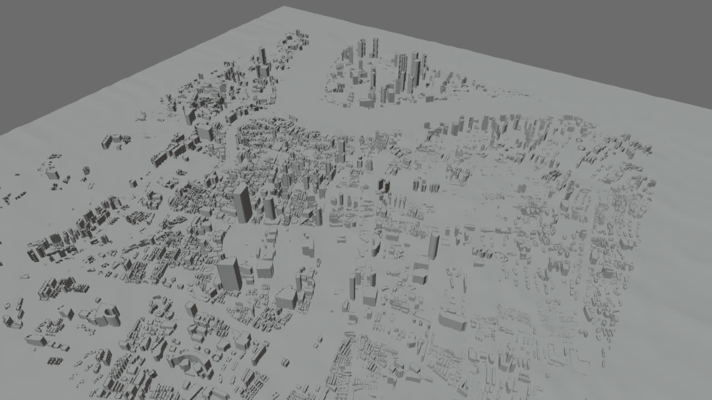
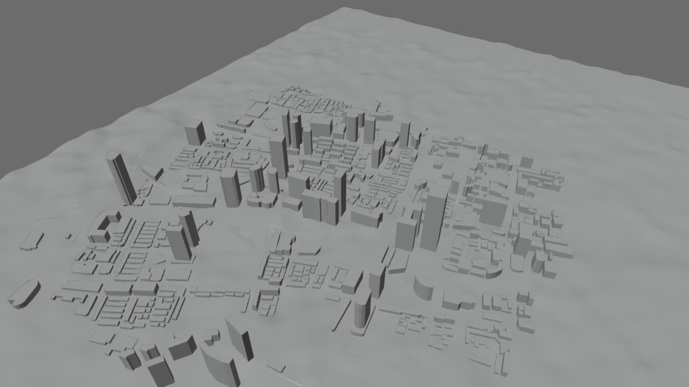
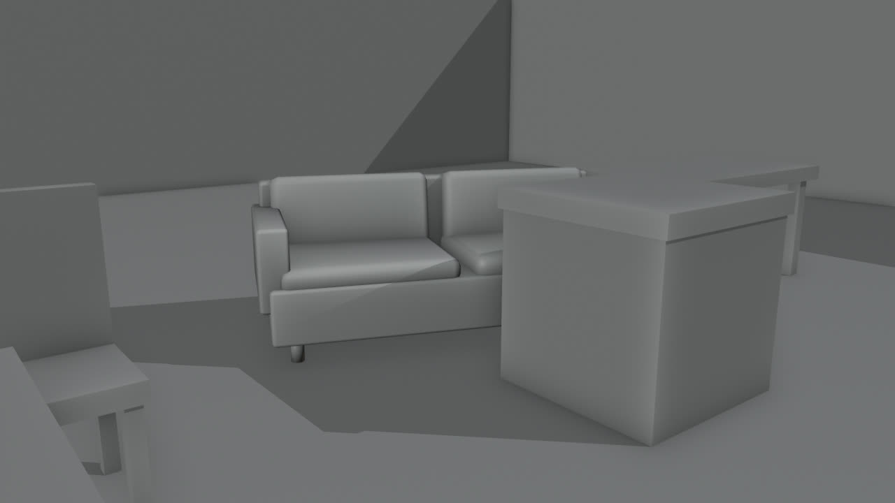
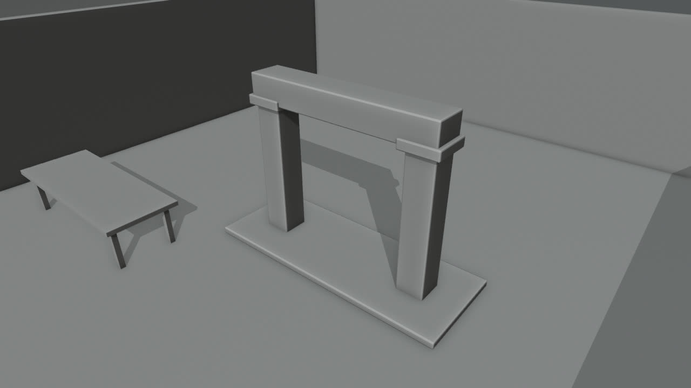

# OpenVideoForge（OVF）

> **VideoForge 的插件**：Agent 造模型 → 工作台排位 / 运镜 / 时间线 → Blender 出成片。
> 自带 MCP server，让任意 Agent 直接驱动这条链路。

**OpenVideoForge 不是独立软件** —— 电商棚拍等业务能力的主入口在
[VideoForge](https://github.com/Lance-9527/VideoForge) 客户端里，本项目是它下面的
「3D 白膜 / 预演」插件：负责把一句话变成**可排布的 3D 场景与分镜时间线**，并把成片渲出来。

---

## 目录

- [快速开始](#快速开始)
- [成品示例](#成品示例)
- [接入 Agent（MCP）](#接入-agentmcp)
- [它能做什么](#它能做什么)
- [目录结构](#目录结构)
- [环境变量](#环境变量)
- [与 VideoForge 的关系](#与-videoforge-的关系)
- [已知限制](#已知限制)
- [许可](#许可)

---

## 快速开始

**要求**：Node.js ≥ 18。零第三方依赖、零构建步骤。

```bash
git clone https://github.com/Lance-9527/OpenVideoForge.git
cd OpenVideoForge
node bin/cli.mjs open
```

`open` 会起页面服务 + 桥，并打开浏览器：

- 页面：<http://127.0.0.1:8802/index.html>（**必须走 `http://`**，浏览器会拦 `file://` 下的 iframe）
- 桥：<http://127.0.0.1:8787>（Agent 指令通道）

其它子命令：

| 命令 | 作用 |
|---|---|
| `node bin/cli.mjs open` | 起页面 + 桥，并打开浏览器（人用） |
| `node bin/cli.mjs serve` | 只起页面 + 桥（无 GUI / 远程） |
| `node bin/cli.mjs mcp` | 以 MCP stdio 服务运行（Agent 用，同时仍监听 HTTP 端口） |

### 可选依赖

| 依赖 | 用来做什么 | 没有会怎样 |
|---|---|---|
| **VideoForge 渲染服务**（`127.0.0.1:8765`） | 白膜 / 成片渲染（Blender 出片） | 只能用「浏览器预演」，不能出 MP4 |
| **Blender 4.2 LTS** | 把 3D 场景渲成白膜与成片 | 同上 |
| **Python**（能 import fastapi + uvicorn） | 拉起 VideoForge 的 sidecar 后端 | 同上 |

三者都可用环境变量覆盖，见下面的[环境变量](#环境变量)。

### 跑测试

```bash
npm test        # 单测 20 套 / 666 断言
```

---

## 成品示例

入口页有一块「**成品示例**」，打开就能点开播放 —— 下面这些**全部由本项目自己跑出来**，
不是渲染图，是真跑一遍的产物：

| 上海黄浦区 · 全境白膜 | 上海黄浦区 · 核心街区 |
|---|---|
|  |  |
| OSM 全量建筑与路网，一个镜头看完整个区 | 缩小半径重抓，看清楼宇与街道的相对关系 |

| 沙发产品片 · 室内棚拍 | 门楼牌坊 · 帧级镜头 |
|---|---|
|  |  |
| Agent 生成 GLB → 摆进影棚 → 加灯光机位 | 10 秒多镜头时间线，逐帧可对齐 |

其余成品（沙发多机位、室内楼层爆炸图）在入口页的「成品示例」板块里，
点开即播。

> 真实世界那几条的数据来自 [OpenStreetMap](https://www.openstreetmap.org/copyright)（ODbL），
> 对外发布含这些数据的作品时同样需要署名 **© OpenStreetMap contributors**。

---

## 接入 Agent（MCP）

仓库里带了现成的 MCP 配置：`.mcp.json`。

```json
{
  "mcpServers": {
    "openvideoforge": {
      "command": "node",
      "args": ["bin/cli.mjs", "mcp"],
      "env": {
        "WBWB_OUT_DIR": "",
        "WBWB_PORT": "8787",
        "WBWB_VF_URL": "http://127.0.0.1:8765"
      }
    }
  }
}
```

把它复制到你的 MCP 客户端配置目录，**并让客户端以仓库根目录为工作目录启动**
（`args` 里的是相对路径）。

> ⚠️ 本项目**暂未发布到 npm**。网上如果看到 `npx -y openvideoforge mcp` 的写法，
> 那份包并不存在（实测 404）——请用上面的源码方式，或先 `npm link` 本仓库。

桥同时提供 HTTP 通道（非 MCP 客户端也能接）：

```bash
GET  /health        → {"ok":true,"page":true}
POST /cmd           → {name, args, timeoutMs}  → {ok, data|error}
GET  /events        → SSE：桥 → 页面下发指令
```

协议细节见 [`docs/AGENT-PROTOCOL.md`](./docs/AGENT-PROTOCOL.md)。

---

## 它能做什么

**71 个 MCP 工具**，覆盖这几类：

| 类别 | 代表工具 |
|---|---|
| 场景 | `wb_scene_new` `wb_env_load` `wb_state` `wb_share_link` |
| 资产 | `wb_add_asset` `wb_array` `wb_asset_upload` `wb_asset_list` `wb_delete_selected` |
| 灯光 / 调色 | `wb_light` `wb_grade` `wb_panorama` `wb_camera` |
| 镜头 / 时间线 | `wb_shot_add` `wb_shot_list` `wb_shot_preview` `wb_play` `wb_storyboard` |
| 真实世界 | `wb_world_build` `wb_world_list` `wb_world_info` `wb_building_list` `wb_building_floor` |
| 设备 / 机位 | `wb_device_add` `wb_device_aim` `wb_device_look` `wb_device_shoot` |
| 渲染 | `wb_render` `wb_render_batch` `wb_render_frames` `wb_render_save` `wb_studio_render` |
| 视频 | `wb_video` `wb_handoff` `wb_handoff_check` |
| 高斯泼溅 | `wb_splat_cmd` `wb_splat_tools` `wb_splat_results` `wb_previz_import_scene` |
| 片库 / 预设 | `wb_library_list` `wb_library_save_world` `wb_preset_save` `wb_preset_load` |

**人也能用同一套能力**：页面右侧「AI 指令」窗输入自然语言或直接发 JSON，
与 Agent 走同一条指令总线（`window.WB_AGENT.run(name, args)`）。

---

## 目录结构

```
openvideoforge/
├── bin/cli.mjs              # 命令行入口（open / serve / mcp）
├── server/
│   ├── agent-bridge.mjs     # 指令桥：HTTP + SSE + MCP over stdio（零依赖）
│   ├── paths.mjs            # 跨平台默认目录（产物 / 数据 / 工具 / 截图）
│   ├── osm.mjs              # Overpass 抓取 + 本地落盘缓存
│   ├── vf-autostart.mjs     # 自动探测 / 拉起 VideoForge sidecar
│   └── …                    # inbox / library / presets / terrain / geocode …
├── js/                      # 前端（工作台、编辑器、AI 指令面板、3D 场景）
├── css/                     # 样式（明暗双主题）
├── assets/                  # 静态资源（含 three.js r160 构建）
├── js/vendor/               # three.js addons + 许可全文
├── agent-side/              # Agent 侧脚本（Blender 造模型）
├── plugin/                  # 插件清单（plugin.json）+ 技能（SKILL.md）
├── tools/                   # 验收 / 巡检 / 抓取等开发脚本
├── tests/                   # 单测（20 套 / 666 断言）
├── docs/                    # 协议、能力、限制、开发记录
└── index.html               # 工作台入口
```

---

## 环境变量

| 变量 | 作用 | 默认值 |
|---|---|---|
| `WBWB_OUT_DIR` | 产物目录（模型 / 渲染产物 / 导出） | `<用户目录>/Downloads/OpenVideoForge` |
| `WBWB_PORT` | 指令桥端口 | `8787` |
| `WBWB_STATIC_PORT` | 页面服务端口 | `8802` |
| `WBWB_VF_URL` | VideoForge 渲染服务地址 | `http://127.0.0.1:8765` |
| `VIDEOFORGE_DATA_DIR` | VideoForge 业务数据目录 | `<用户目录>/.videoforge` |
| `VIDEOFORGE_BACKEND_DIR` | sidecar 的 backend 目录 | 自动探测 |
| `VIDEOFORGE_PYTHON` | Python 可执行文件 | 自动探测 |
| `VIDEOFORGE_BLENDER` | Blender 可执行文件 | 自动探测 |
| `OVF_TOOLS_DIR` | 第三方工具目录（Blender 便携版等） | `<用户目录>/Tools` |

---

## 与 VideoForge 的关系

```
VideoForge（桌面应用，MIT）
  └─ 业务层：电商棚拍 / 商品图 / 商品视频
       └─ OpenVideoForge（本项目，MIT）
            · 网页 3D 白膜工作台（摆位 / 运镜 / 时间线）
            · 真实世界数据（OSM 建筑 / 道路 / 河流）
            · Blender 白膜与成片渲染
            · MCP server（供任意 Agent 驱动）
```

- VideoForge 客户端负责「跟人对话、收审批、开浏览器」；
  本项目负责「3D 场景怎么摆、镜头怎么动、怎么出片」。
- 本项目**不依赖** VideoForge 客户端也能跑（只是不能出 MP4）。

---

## 已知限制

- **必须走 `http://`**：`file://` 下浏览器会拦 iframe，页面打不开。
- **Blender 后端是可选的**：没有它只能做浏览器内预演。
- **验收脚本依赖 CDP**：部分 `tools/ovf-*.mjs` 要连本机 Chrome 的调试端口。
- **验收器时序问题**：`cmd asset.transform` 在验收器里偶发失败，单测复测正常（未根治）。

完整的能力演进记录见 [`docs/开发记录.md`](./docs/开发记录.md)。

---

## 许可

MIT，见 [`LICENSE`](./LICENSE)。

随包分发的第三方组件（three.js r160 / onnx 等）见
[`THIRD-PARTY-NOTICES.md`](./THIRD-PARTY-NOTICES.md)。

> **数据署名义务**：本项目可抓取并缓存 OpenStreetMap 数据（ODbL）。
> 对外发布含 OSM 数据的作品时，必须署名 **© OpenStreetMap contributors**。
> 归一化流程会把 attribution 保留在场景里，出片/导出时写进片尾或字幕。

---

## 致谢

- 底座与最初的形态来自 [whitebox-workbench](https://github.com/Twdhsi-666/whitebox-workbench)（MIT），
  本项目是它的产品化分支。
- 真实世界数据来自 [OpenStreetMap](https://www.openstreetmap.org/copyright)（ODbL）。
